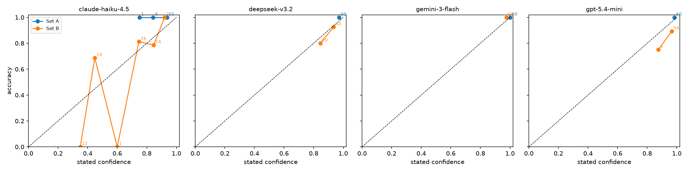
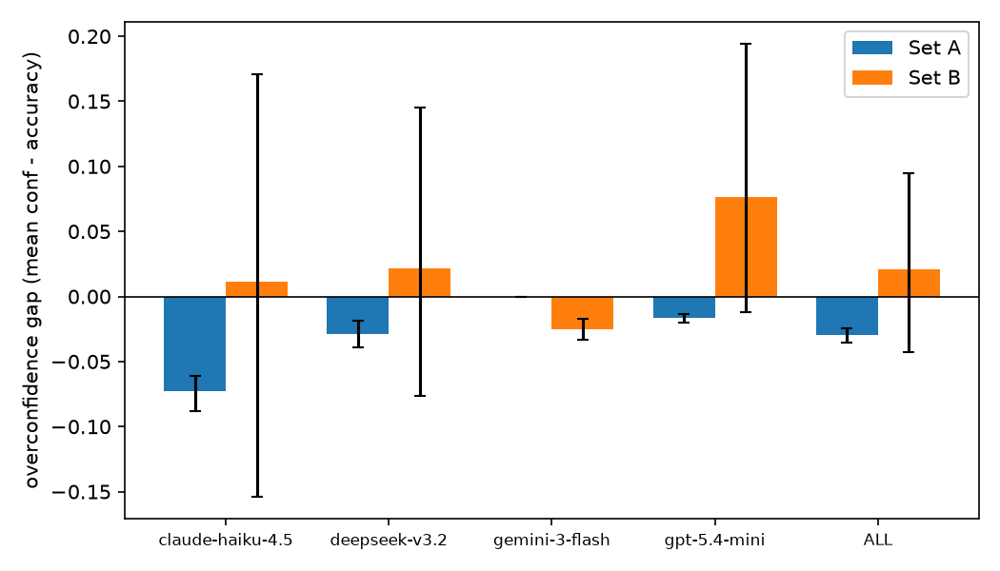

<!--
TODO (author): port this Markdown into the official Apart Research template before export.
TODO (author): every number below is copied from results/summary.csv, results/bootstrap.csv,
results/per_question.csv, results/grading_counts.csv or results/needs_review.csv. Re-run
`python3 src/check_report_numbers.py` after any edit.
-->

# Confidently Wrong Underground? A Pilot Study of LLM Calibration on Nigerian Regional Geology vs. Global Textbook Geology

**Author:** Emmanuel (B.Tech Geology)
**Track:** 1, Model Epistemics and Decision-Making Evals
**Status:** pilot study

## Abstract

Large language models (LLMs) are increasingly consulted on technical questions where local knowledge matters, including resource and groundwater decisions in Africa. We ask whether models lose accuracy on under-represented regional geology while keeping the same stated confidence. In this pilot study we built two 20-question short-answer sets. Set A covers global textbook geology, including well-documented regional formation names. Set B covers Nigerian regional geology: the Basement Complex, Benue Trough, Niger Delta, Anambra Basin, Jos Younger Granites, and the Chad, Sokoto and Bida basins. Four models (claude-haiku-4.5, deepseek-v3.2, gemini-3-flash, gpt-5.4-mini) answered each question three times at temperature 0.7 and stated a 0–100 confidence, giving 480 responses. All four models answered every Set A question correctly. Pooled over models, Set B accuracy was 0.8417 with mean confidence 0.8628. The overconfidence gap (mean confidence minus accuracy) was −0.0297 on Set A and 0.0211 on Set B. The between-set difference in gap was 0.0508 (95% question-level bootstrap CI −0.0120 to 0.1251). Only for gpt-5.4-mini did the interval exclude zero in the hypothesised direction (0.0933, CI 0.0071 to 0.2058). claude-haiku-4.5 had the largest accuracy drop (1.0000 to 0.6000) but also lowered its mean confidence (0.9270 to 0.6112). The evidence for the hypothesis is therefore mixed and model-dependent. A ceiling effect on Set A, the small sample, and LLM-assisted grading of 94 responses limit these conclusions.

## 1. Introduction

When a model gives a wrong answer with high confidence, a user has no signal to double-check it. This matters most where users cannot easily verify answers themselves, and where training data are thin. Regional geology is such a domain: the stratigraphy, structure and mineral occurrences of Nigerian sedimentary basins are documented mainly in regional textbooks, national survey reports and regional journals (e.g. Obaje, 2009), which are likely to be less represented in web-scale training corpora than global textbook material. Language-model accuracy on factual questions is strongly related to how many relevant documents appeared in pre-training (Kandpal et al., 2022), and LLM knowledge shows systematic geographic biases (Manvi et al., 2024), so regional geology is plausibly long-tail knowledge for current models.

**Research question.** Do LLMs lose accuracy on under-represented regional geology while keeping the same stated confidence?

**Hypothesis.** Accuracy drops on the Nigerian set, stated confidence drops less, so the overconfidence gap is larger on the Nigerian set.

**Contributions.** This is a pilot study. We contribute:
1. A 40-item short-answer calibration set (20 global, 20 Nigerian regional), with accepted answer variants and source pointers.
2. Evidence from four models on whether verbalized confidence tracks the accuracy drop on the regional set.
3. A short discussion of why this matters for AI use in African resource and groundwater decisions.

## 2. Related Work

**Calibration of neural networks.** Guo et al. (2017) showed that modern neural networks are poorly calibrated and evaluated post-hoc calibration methods; following common practice, we summarise calibration with a 10-bin expected calibration error (ECE).

**Do language models know what they know?** Kadavath et al. (2022) studied whether language models can evaluate the correctness of their own answers and found that larger models are reasonably well calibrated on many multiple-choice and true/false formats.

**Verbalized confidence.** Tian et al. (2023) found that for models fine-tuned with human feedback, confidence stated in words can be better calibrated than the model's conditional probabilities. Xiong et al. (2023) systematically evaluated confidence-elicitation strategies and reported that verbalized confidences tend to be overconfident, and that all investigated methods struggle on tasks requiring professional knowledge. Our design uses a simple verbalized confidence (0–100 integer in JSON), and we treat it as self-report, not as a true probability.

**Long-tail and geographic knowledge.** Kandpal et al. (2022) found that a model's ability to answer a factual question relates to how many associated documents it saw in pre-training. Manvi et al. (2024) studied what LLMs know about the world through a geographic lens and reported systematic geographic biases.

**Geoscience LLMs.** Deng et al. (2023) introduced K2, a geoscience language model, together with geoscience instruction data and a benchmark. We did not find a prior study of verbalized calibration on African regional geology. The Nigerian answer key draws on the standard regional reference (Obaje, 2009) and on works cited per item in Appendix B.

## 3. Methodology

**Question sets.** Set A has 20 global geology questions (petrology, metamorphism, ore deposits, sedimentology, tectonics), including five formation-name questions about well-documented non-African units (Marcellus Shale, Burgess Shale, Morrison Formation, Navajo Sandstone, Bakken Formation). These were added so that both sets contain formation-name items, reducing a question-type confound. Set B has 20 Nigerian questions spanning the Basement Complex, Benue Trough, Niger Delta, Anambra Basin, Jos Younger Granites, Chad (Bornu), Sokoto and Bida basins, and mineral occurrences. Each item has a gold answer of one to five words, a list of accepted variants, and a source. Before submission, every gold answer was checked against openable web sources by an LLM research assistant; all 40 were confirmed (`data/source_check_A.csv`, `data/source_check_B.csv`), although most of that evidence comes from papers, survey pages and a stratigraphic lexicon rather than from the textbooks cited per item. Questions were drafted with LLM assistance and reviewed for answer leakage and contested answers before the run; 5 of an initial 25 Set B items were removed for being generic, ambiguous or guessable. The full list is in Appendix B.

**Models.** Four models from four developers (Anthropic, DeepSeek, Google, OpenAI), accessed through one OpenAI-compatible gateway on 16 November 2026 under the gateway ids `claude-haiku-4.5`, `deepseek-v3.2`, `gemini-3-flash` and `gpt-5.4-mini`. The run log records the requested id only. A probe made after the run (`results/model_identity.jsonl`) showed the gateway serving these ids as `anthropic/claude-haiku-4.5`, `deepseek/deepseek-v3.2`, `gemini-3-flash-preview` (a preview release) and `gpt-5.4-mini-2026-03-17`.

**Prompt.** Each question was sent as a single user message:

```
answer the geology question below. reply in json only:
{"answer": "<short answer>", "confidence": <0-100 integer>}
confidence is your probability that your answer is correct.
question: {question}
```

Each model answered each question 3 times at temperature 0.7 (4 × 40 × 3 = 480 calls). Every call and response is logged in `results/raw.jsonl`.

**Grading.** Answers were auto-graded correct when, after lowercasing, removing punctuation and a leading "the", they exactly matched the gold answer or an accepted variant (386 responses). The remaining 94 responses (62 distinct answers) were graded against written rules (Appendix B). Because of time constraints, these 94 grades were assigned by an LLM assistant (Claude) rather than by the author, and are labelled as such in `results/graded.csv`. To check these grades, a second model from a different developer than the first grader (`deepseek-v4-flash`, temperature 0; note that its developer also made evaluated model deepseek-v3.2) graded the same 62 distinct answers blind to the first grade; the two graders agreed on 62 of 62 distinct answers (94 of 94 responses; `results/grading_agreement.csv`). All 480 responses parsed as valid JSON; none were excluded.

**Metrics.** Confidence is divided by 100. Per model and set we report accuracy, mean confidence, overconfidence gap (mean confidence − accuracy), Brier score, and ECE with 10 equal-width bins. We estimate the difference in gap between sets (gap B − gap A) with a 95% percentile interval from 2000 bootstrap resamples. Questions, not individual responses, are resampled within each set, keeping the three repeats (and, for the pooled estimate, all models) of a question together, because repeats of the same question are not independent.

## 4. Results

**Table 1.** Per-model results (n = 60 responses per model per set; 20 questions × 3 repeats; ALL pools 240).

| Model | Set | Accuracy | Mean conf. | Gap | Brier | ECE |
|---|---|---|---|---|---|---|
| claude-haiku-4.5 | A | 1.0000 | 0.9270 | −0.0730 | 0.0066 | 0.0730 |
| claude-haiku-4.5 | B | 0.6000 | 0.6112 | 0.0112 | 0.1843 | 0.1768 |
| deepseek-v3.2 | A | 1.0000 | 0.9708 | −0.0292 | 0.0016 | 0.0292 |
| deepseek-v3.2 | B | 0.8833 | 0.9050 | 0.0217 | 0.1013 | 0.0217 |
| gemini-3-flash | A | 1.0000 | 1.0000 | 0.0000 | 0.0000 | 0.0000 |
| gemini-3-flash | B | 1.0000 | 0.9748 | −0.0252 | 0.0012 | 0.0252 |
| gpt-5.4-mini | A | 1.0000 | 0.9833 | −0.0167 | 0.0004 | 0.0167 |
| gpt-5.4-mini | B | 0.8833 | 0.9600 | 0.0767 | 0.1035 | 0.0767 |
| ALL | A | 1.0000 | 0.9703 | −0.0297 | 0.0021 | 0.0297 |
| ALL | B | 0.8417 | 0.8628 | 0.0211 | 0.0976 | 0.0618 |

**Table 2.** Difference in overconfidence gap (Set B − Set A), 95% question-level bootstrap CI (2000 resamples, seed 20261116).

| Model | Gap B − Gap A | 95% CI |
|---|---|---|
| claude-haiku-4.5 | 0.0842 | [−0.0729, 0.2517] |
| deepseek-v3.2 | 0.0508 | [−0.0502, 0.1805] |
| gemini-3-flash | −0.0252 | [−0.0333, −0.0168] |
| gpt-5.4-mini | 0.0933 | [0.0071, 0.2058] |
| ALL | 0.0508 | [−0.0120, 0.1251] |





**Accuracy.** Every model answered every Set A question correctly in all three repeats. On Set B, accuracy was lower for three of four models (claude-haiku-4.5 0.6000; deepseek-v3.2 and gpt-5.4-mini 0.8833); gemini-3-flash answered every Set B question correctly.

**Confidence.** claude-haiku-4.5 lowered its mean confidence on Set B (0.9270 → 0.6112) roughly in step with its accuracy, ending with a small positive gap (0.0112). gpt-5.4-mini kept high confidence on Set B (0.9600) while accuracy fell to 0.8833, giving the largest Set B gap (0.0767). deepseek-v3.2 was in between (confidence 0.9050, gap 0.0217).

**Gap difference.** Pooled across models, the gap was larger on Set B by 0.0508, but the interval includes zero (−0.0120 to 0.1251). Only gpt-5.4-mini's interval excludes zero in the hypothesised direction (0.0071 to 0.2058). gemini-3-flash's interval excludes zero in the opposite direction (entirely negative); because it was correct on every item in both sets, its gap only reflects confidence slightly below 1.0, and its narrow interval should not be read as precision about calibration under error.

**Where models failed.** Pooled over models, the hardest Set B items were B22 (ironstone-hosting formation near Lokoja; accuracy 0.3333) and B17 (Paleocene limestone quarried near Sokoto; 0.5000), with mean confidences of 0.7992 and 0.8025 (`results/per_question.csv`). Several incorrect answers named a real formation from the same basin but the wrong unit, for example "Patti Formation" or "Lokoja Formation" for B22 and "Dange Formation" for B17 (`results/needs_review.csv`).

## 5. Discussion

The hypothesis is only partly supported. Accuracy dropped on Nigerian regional geology for three of four models, consistent with weaker coverage of regional material. But whether confidence failed to drop with it depended on the model: one model (gpt-5.4-mini) kept confidence high and showed a gap difference whose interval excludes zero; another (claude-haiku-4.5) showed the largest accuracy drop yet lowered its confidence by a similar amount; and one (gemini-3-flash) made no errors at all. With 20 questions per set, the pooled interval includes zero, so this pilot does not establish a general effect.

The failure pattern is still relevant to practice. Errors that name a real formation from the right basin look plausible to a non-specialist. If a model attaches high stated confidence to such answers, a user relying on that confidence for, for example, siting a borehole or screening a mineral prospect has little reason to check. Even in this small sample, mean Set B confidence for two models was 0.9050 and 0.9600 while accuracy was 0.8833.

Practical next steps are: a larger Set B with author-verified sources; harder Set A items to remove the ceiling; full expert grading; and more models, including larger ones.

## References

- Deng, C., Zhang, T., He, Z., Xu, Y., et al. (2023). K2: A Foundation Language Model for Geoscience Knowledge Understanding and Utilization. https://arxiv.org/abs/2306.05064
- Guo, C., Pleiss, G., Sun, Y., & Weinberger, K. Q. (2017). On Calibration of Modern Neural Networks. *ICML 2017*. https://arxiv.org/abs/1706.04599
- Kadavath, S., Conerly, T., Askell, A., et al. (2022). Language Models (Mostly) Know What They Know. https://arxiv.org/abs/2207.05221
- Kandpal, N., Deng, H., Roberts, A., Wallace, E., et al. (2022). Large Language Models Struggle to Learn Long-Tail Knowledge. https://arxiv.org/abs/2211.08411
- Manvi, R., Khanna, S., Burke, M., Lobell, D., et al. (2024). Large Language Models are Geographically Biased. https://arxiv.org/abs/2402.02680
- Obaje, N. G. (2009). *Geology and Mineral Resources of Nigeria*. Lecture Notes in Earth Sciences 120. Springer. https://doi.org/10.1007/978-3-540-92685-6
- Tian, K., Mitchell, E., Zhou, A., et al. (2023). Just Ask for Calibration: Strategies for Eliciting Calibrated Confidence Scores from Language Models Fine-Tuned with Human Feedback. https://arxiv.org/abs/2305.14975
- Xiong, M., Hu, Z., Lu, X., et al. (2023). Can LLMs Express Their Uncertainty? An Empirical Evaluation of Confidence Elicitation in LLMs. https://arxiv.org/abs/2306.13063

## Appendix A: Limitations and Dual-Use / Ethical Considerations

**Limitations.**
- **Small n.** 20 questions per set, 3 repeats, 4 models (480 responses). Confidence intervals are wide; this is a pilot.
- **Ceiling effect on Set A.** All models scored 1.0000 on Set A, so the Set A gap can only be zero or negative. This biases the gap difference upward and means Set A does not test calibration under error.
- **Answer key.** The key was drafted with LLM assistance and reviewed by a single author. Each gold answer was then checked against web sources by an LLM assistant (40 of 40 confirmed), not page-by-page by the author against the cited textbooks. Two wording issues were found after the run and left unchanged so the data stay valid: A03 calls the Morrison Formation the "most prolific" source of North American dinosaur fossils, which the sources found did not state; and for A15, "downlap surface" would arguably also be correct (no model gave it).
- **Grading.** 94 of 480 responses required judgement and were graded by an LLM assistant (Claude), not by the domain expert. Claude is from the same developer as one evaluated model (claude-haiku-4.5). A blind second LLM grader (deepseek-v4-flash, from the same developer as evaluated model deepseek-v3.2) agreed on all 94 responses, but agreement between two LLMs is not a substitute for expert grading. Borderline calls are listed in Appendix B.
- **Possible contamination.** Some items, especially Set A, are likely to appear in training data. Set B items may also appear in regional literature online.
- **Self-reported confidence.** The JSON confidence is a verbalized self-report, not a calibrated probability, and is sensitive to prompt wording.
- **Model and date specificity.** Results apply to the four models as served by one gateway on 16 November 2026, with one prompt and temperature 0.7. The served model version was not logged per call; it was recorded by a single probe after the run. gemini-3-flash was served as a preview release (`gemini-3-flash-preview`), which may change without notice.

**Dual-use and ethics.** Misuse risk is low: the dataset contains public geological facts and no hazardous information. The main risk is to evaluation validity: if the question set is published, future models could be trained or tuned on it, so later results on this set may overstate regional knowledge. A held-out portion should be kept private in future versions.

## Appendix B: Grading Notes and Full Question List

### B.1 Grading rules

1. Correct if the primary answer names the gold unit or concept or an accepted variant, ignoring articles, abbreviations in parentheses (e.g. "(K-Pg)", "(MVT)"), alternate spellings and added descriptors ("Formation", "deposits").
2. Hedged answers "X (or Y)" are graded on X.
3. A more specific but consistent answer is correct (B14 "Late Jurassic" for "Jurassic").
4. A full sentence that names the gold answer is correct.
5. Incorrect if the answer names a different formation, basin, stage or granite suite.

**Borderline calls.** B18 "The Abakaliki Shale (often referred to as the Asu River Group)" was graded correct (1 response). B22 "Patti Formation" (5 responses) and "Lokoja Formation" (2 responses) were graded incorrect: the Agbaja ironstone overlies the Patti Formation, although ironstone beds within the Patti have been reported.

Grading counts (`results/grading_counts.csv`): 386 auto-graded, 94 graded by Claude. Blind second grader (deepseek-v4-flash) agreement: 62 of 62 distinct answers, 94 of 94 responses (`results/grading_agreement.csv`; raw calls in `results/second_grader.jsonl`).

### B.2 Full question list

Set B IDs are not contiguous because five draft items were removed before the run (B04, B06, B09, B16, B24). Web-check evidence (URL and quote per item) is in `data/source_check_A.csv` and `data/source_check_B.csv`.

| ID | Set | Question | Gold answer | Accepted variants | Source | Difficulty | Web check |
|---|---|---|---|---|---|---|---|
| A01 | A | Which Middle Devonian organic-rich shale formation of the Appalachian Basin is a major U.S. shale-gas play? | Marcellus Shale | Marcellus\|Marcellus Formation | USGS (2019) Assessment of undiscovered gas resources in the Middle Devonian Marcellus Shale of the Appalachian Basin Province, http://www.usgs.gov/publications/assessment-undiscovered-gas-resources-middle-devonian-marcellus-shale-appalachian | medium | confirmed |
| A02 | A | Which Middle Cambrian fossil Lagerstätte in Yoho National Park, British Columbia, preserves exceptional soft-bodied fauna? | Burgess Shale | Burgess\|Burgess Shale Formation | IUGS Geological Heritage Sites: Burgess Shale Cambrian Palaeontological Record, https://iugs-geoheritage.org/?p=3027 | medium | confirmed |
| A03 | A | Which Upper Jurassic formation of the western United States is the most prolific source of North American dinosaur fossils? | Morrison Formation | Morrison | U.S. National Park Service: Jurassic Dinosaurs, https://home.nps.gov/subjects/fossils/jurassic-dinosaurs.htm | medium | confirmed |
| A04 | A | Which Lower Jurassic eolian formation forms the high cross-bedded cliffs of Zion National Park, Utah? | Navajo Sandstone | Navajo\|Navajo Formation | U.S. National Park Service, Zion: Navajo Sandstone, https://www.nps.gov/zion/learn/nature/navajo.htm | medium | confirmed |
| A05 | A | Which geological time boundary is marked worldwide by an iridium-enriched clay layer linked to an asteroid impact? | Cretaceous-Paleogene boundary | K-Pg boundary\|K-Pg\|K-T boundary\|KT boundary\|K/T boundary\|Cretaceous-Tertiary boundary\|Cretaceous-Paleogene\|Cretaceous-Tertiary | Marshak S. Earth: Portrait of a Planet, W.W. Norton; Alvarez L.W. et al. (1980) Science 208 | easy | confirmed |
| A06 | A | Which Late Devonian-Early Mississippian formation of the Williston Basin is a major tight-oil play in North Dakota? | Bakken Formation | Bakken\|Bakken Shale | Pollastro R.M. et al. (2008) USGS Fact Sheet 2008-3021, https://pubs.usgs.gov/fs/2008/3021/ | medium | confirmed |
| A07 | A | Which index mineral defines the highest-grade zone of the classic Barrovian metamorphic sequence in the Scottish Highlands? | Sillimanite | sillimanite zone | Winter J.D. (2010) Principles of Igneous and Metamorphic Petrology, 2nd ed., Pearson | medium | confirmed |
| A08 | A | Which metamorphic facies is characterized by the assemblage glaucophane + lawsonite in metabasites? | Blueschist facies | blueschist\|glaucophane schist facies\|glaucophane-lawsonite schist facies | Winter J.D. (2010) Principles of Igneous and Metamorphic Petrology, 2nd ed., Pearson | medium | confirmed |
| A09 | A | What ultramafic volcanic rock, mainly of Archean age, is characterized by spinifex texture? | Komatiite | komatiites\|komatiitic lava | Winter J.D. (2010) Principles of Igneous and Metamorphic Petrology, 2nd ed., Pearson | medium | confirmed |
| A10 | A | What type of ore deposit forms where a granitic intrusion metasomatizes adjacent carbonate rocks to produce calc-silicate assemblages? | Skarn | skarn deposit\|skarns\|contact metasomatic deposit | Robb L. (2005) Introduction to Ore-Forming Processes, Blackwell | medium | confirmed |
| A11 | A | What is the name of the idealized five-division (Ta-Te) vertical sequence deposited by a waning turbidity current? | Bouma sequence | Bouma\|Bouma cycle | Nichols G. (2009) Sedimentology and Stratigraphy, 2nd ed., Wiley-Blackwell; Bouma A.H. (1962) Sedimentology of Some Flysch Deposits, Elsevier | medium | confirmed |
| A12 | A | What type of sedimentary basin forms by flexural loading of the lithosphere in front of a fold-thrust belt? | Foreland basin | foreland\|foredeep\|peripheral foreland basin\|retroarc foreland basin | Allen P.A. & Allen J.R. (2013) Basin Analysis, 3rd ed., Wiley-Blackwell | medium | confirmed |
| A13 | A | What class of carbonate-hosted, epigenetic Pb-Zn deposits with no obvious igneous source is named after a North American river basin? | Mississippi Valley-type | MVT\|Mississippi Valley type\|Mississippi Valley-type deposit\|MVT deposit | Robb L. (2005) Introduction to Ore-Forming Processes, Blackwell | medium | confirmed |
| A14 | A | Which stratigraphic principle states that, in a conformable succession, vertically adjacent facies were deposited in laterally adjacent environments? | Walther's Law | Walther's Law of Facies\|Walther law\|Walthers law\|law of correlation of facies | Nichols G. (2009) Sedimentology and Stratigraphy, 2nd ed., Wiley-Blackwell | medium | confirmed |
| A15 | A | In sequence stratigraphy, what surface separates the transgressive systems tract from the overlying highstand systems tract? | Maximum flooding surface | MFS | Catuneanu O. (2006) Principles of Sequence Stratigraphy, Elsevier | hard | confirmed |
| A16 | A | In the forsterite-silica binary system, what type of invariant point causes early olivine to react with melt to form enstatite? | Peritectic | peritectic point\|reaction point | Winter J.D. (2010) Principles of Igneous and Metamorphic Petrology, 2nd ed., Pearson | hard | confirmed |
| A17 | A | What high-pressure SiO2 polymorph, found as inclusions in garnet, is diagnostic of ultrahigh-pressure metamorphism of continental crust? | Coesite |  | Winter J.D. (2010) Principles of Igneous and Metamorphic Petrology, 2nd ed., Pearson; Chopin C. (1984) Contributions to Mineralogy and Petrology 86 | hard | confirmed |
| A18 | A | What Mesoproterozoic (c. 1.1 Ga) orogeny of eastern North America is associated with the assembly of Rodinia? | Grenville orogeny | Grenville\|Grenvillian orogeny\|Grenvillian | Kearey P., Klepeis K.A., Vine F.J. (2009) Global Tectonics, 3rd ed., Wiley-Blackwell | hard | confirmed |
| A19 | A | What is the name of the large, well-exposed Cretaceous ophiolite in Oman? | Semail ophiolite | Samail ophiolite\|Semail\|Samail | Kearey P., Klepeis K.A., Vine F.J. (2009) Global Tectonics, 3rd ed., Wiley-Blackwell | hard | confirmed |
| A20 | A | What sodic clinopyroxene (jadeite-diopside solid solution) coexists with garnet to define eclogite? | Omphacite |  | Winter J.D. (2010) Principles of Igneous and Metamorphic Petrology, 2nd ed., Pearson | hard | confirmed |
| B01 | B | Which paralic sand-shale formation of the Niger Delta hosts most of its hydrocarbon reservoirs? | Agbada Formation | Agbada | Short K.C. & Stauble A.J. (1967) Outline of geology of Niger Delta, AAPG Bulletin 51(5); Doust H. & Omatsola E. (1990) Niger Delta, in AAPG Memoir 48; Obaje N.G. (2009) Geology and Mineral Resources of Nigeria, Lecture Notes in Earth Sciences 120, Springer | easy | confirmed |
| B02 | B | Which orogeny, at about 600 Ma, imposed the dominant deformation and metamorphism on the Nigerian Basement Complex? | Pan-African orogeny | Pan-African\|Pan African\|Pan-African event | Rahaman M.A. (1988) Recent advances in the study of the Basement Complex of Nigeria, in Precambrian Geology of Nigeria, Geological Survey of Nigeria; Obaje N.G. (2009) Geology and Mineral Resources of Nigeria, Lecture Notes in Earth Sciences 120, Springer | easy | confirmed |
| B03 | B | What collective name is given to the Pan-African granitoids that intrude the Nigerian Basement Complex? | Older Granites | Older Granite\|Older Granite suite\|Older Granites suite | Rahaman M.A. (1988) Recent advances in the study of the Basement Complex of Nigeria, in Precambrian Geology of Nigeria, Geological Survey of Nigeria; Obaje N.G. (2009) Geology and Mineral Resources of Nigeria, Lecture Notes in Earth Sciences 120, Springer | easy | confirmed |
| B05 | B | Which two base metals dominate the vein mineralization of the Benue Trough (e.g., Abakaliki, Arufu, Zurak)? | Lead and zinc | lead-zinc\|Pb-Zn\|Pb and Zn\|zinc and lead\|galena and sphalerite | Obaje N.G. (2009) Geology and Mineral Resources of Nigeria, Lecture Notes in Earth Sciences 120, Springer; Benkhelil J. (1989) The origin and evolution of the Cretaceous Benue Trough (Nigeria), Journal of African Earth Sciences 8 | easy | confirmed |
| B07 | B | The Sokoto Basin of northwestern Nigeria is the southeastern sector of which larger intracratonic basin? | Iullemmeden Basin | Iullemmeden\|Iullemeden Basin\|Iullemeden | Obaje N.G. (2009) Geology and Mineral Resources of Nigeria, Lecture Notes in Earth Sciences 120, Springer; Kogbe C.A. (ed.) (1989) Geology of Nigeria, 2nd ed., Rock View, Jos | easy | confirmed |
| B08 | B | What is the basal, overpressured marine prodelta shale formation of the Niger Delta? | Akata Formation | Akata\|Akata Shale | Short K.C. & Stauble A.J. (1967) Outline of geology of Niger Delta, AAPG Bulletin 51(5); Doust H. & Omatsola E. (1990) Niger Delta, in AAPG Memoir 48 | medium | confirmed |
| B10 | B | During which Cretaceous stage did the main compressional folding and uplift of the southern Benue Trough occur, shifting deposition into the Anambra Basin? | Santonian | Santonian stage\|Santonian event\|Santonian folding\|Santonian inversion | Benkhelil J. (1989) The origin and evolution of the Cretaceous Benue Trough (Nigeria), Journal of African Earth Sciences 8; Obaje N.G. (2009) Geology and Mineral Resources of Nigeria, Lecture Notes in Earth Sciences 120, Springer | medium | confirmed |
| B11 | B | What major NE-SW fold structure formed by Santonian inversion of the southern Benue Trough? | Abakaliki Anticlinorium | Abakaliki Anticline\|Abakaliki uplift\|Abakaliki fold belt | Benkhelil J. (1989) The origin and evolution of the Cretaceous Benue Trough (Nigeria), Journal of African Earth Sciences 8; Obaje N.G. (2009) Geology and Mineral Resources of Nigeria, Lecture Notes in Earth Sciences 120, Springer | medium | confirmed |
| B12 | B | Which formation of the Anambra Basin contains the coal seams historically mined at Enugu? | Mamu Formation | Mamu\|Lower Coal Measures | Reyment R.A. (1965) Aspects of the Geology of Nigeria, Ibadan University Press; Obaje N.G. (2009) Geology and Mineral Resources of Nigeria, Lecture Notes in Earth Sciences 120, Springer | medium | confirmed |
| B13 | B | What friable, prominently cross-bedded Maastrichtian sandstone formation overlies the Mamu Formation in the Anambra Basin? | Ajali Sandstone | Ajali Formation\|Ajali\|False-bedded Sandstone | Reyment R.A. (1965) Aspects of the Geology of Nigeria, Ibadan University Press; Obaje N.G. (2009) Geology and Mineral Resources of Nigeria, Lecture Notes in Earth Sciences 120, Springer | medium | confirmed |
| B14 | B | To which geological period are the Jos Plateau Younger Granite ring complexes (e.g., Jos-Bukuru) predominantly dated? | Jurassic | Jurassic period | Obaje N.G. (2009) Geology and Mineral Resources of Nigeria, Lecture Notes in Earth Sciences 120, Springer; Kogbe C.A. (ed.) (1989) Geology of Nigeria, 2nd ed., Rock View, Jos | medium | confirmed |
| B15 | B | What niobium ore mineral was recovered with cassiterite on the Jos Plateau, making Nigeria a leading world producer in the mid-20th century? | Columbite | columbite-tantalite\|niobite | Obaje N.G. (2009) Geology and Mineral Resources of Nigeria, Lecture Notes in Earth Sciences 120, Springer; Wright J.B. et al. (1985) Geology and Mineral Resources of West Africa, Allen & Unwin | medium | confirmed |
| B17 | B | Which Paleocene marine limestone formation of the Sokoto Group is quarried as cement raw material near Sokoto? | Kalambaina Formation | Kalambaina\|Kalambaina Limestone | Obaje N.G. (2009) Geology and Mineral Resources of Nigeria, Lecture Notes in Earth Sciences 120, Springer; Kogbe C.A. (ed.) (1989) Geology of Nigeria, 2nd ed., Rock View, Jos | medium | confirmed |
| B18 | B | What is the oldest dated (Albian) sedimentary unit of the southern (Lower) Benue Trough? | Asu River Group | Asu River Formation\|Asu River Shale\|Asu River | Reyment R.A. (1965) Aspects of the Geology of Nigeria, Ibadan University Press; Obaje N.G. (2009) Geology and Mineral Resources of Nigeria, Lecture Notes in Earth Sciences 120, Springer | hard | confirmed |
| B19 | B | Which Paleocene marine shale overlies the Nsukka Formation in the Anambra Basin? | Imo Formation | Imo Shale\|Imo | Reyment R.A. (1965) Aspects of the Geology of Nigeria, Ibadan University Press; Obaje N.G. (2009) Geology and Mineral Resources of Nigeria, Lecture Notes in Earth Sciences 120, Springer | hard | confirmed |
| B20 | B | What is the basal continental (Early Cretaceous) sandstone formation of the Upper Benue Trough and Nigerian Chad Basin? | Bima Formation | Bima Sandstone\|Bima Group\|Bima | Obaje N.G. (2009) Geology and Mineral Resources of Nigeria, Lecture Notes in Earth Sciences 120, Springer; Nwajide C.S. (2013) Geology of Nigeria's Sedimentary Basins, CSS Press, Lagos | hard | confirmed |
| B21 | B | Which marine shale formation overlies the Gongila Formation in the Nigerian sector of the Chad (Bornu) Basin? | Fika Shale | Fika Formation\|Fika | Obaje N.G. (2009) Geology and Mineral Resources of Nigeria, Lecture Notes in Earth Sciences 120, Springer; Nwajide C.S. (2013) Geology of Nigeria's Sedimentary Basins, CSS Press, Lagos | hard | confirmed |
| B22 | B | In the southern Bida (Mid-Niger) Basin near Lokoja, which Maastrichtian formation hosts the oolitic and pisolitic ironstone deposits? | Agbaja Ironstone | Agbaja Formation\|Agbaja Ironstone Formation\|Agbaja | Obaje N.G. (2009) Geology and Mineral Resources of Nigeria, Lecture Notes in Earth Sciences 120, Springer; Ladipo K.O., Akande S.O. & Mucke A. (1994) Genesis of ironstones from the Middle Niger sedimentary basin, Journal of Mining and Geology 30 | hard | confirmed |
| B23 | B | Which continental formation is the youngest major pre-Quaternary lithostratigraphic unit of the Sokoto Basin? | Gwandu Formation | Gwandu\|Continental Terminal | Obaje N.G. (2009) Geology and Mineral Resources of Nigeria, Lecture Notes in Earth Sciences 120, Springer; Kogbe C.A. (ed.) (1989) Geology of Nigeria, 2nd ed., Rock View, Jos | hard | confirmed |
| B25 | B | Which Oligocene-Miocene formation of southern Nigeria is known for its lignite seams? | Ogwashi-Asaba Formation | Ogwashi-Asaba\|Ogwashi Asaba Formation\|Ogwashi-Asaba lignite | Reyment R.A. (1965) Aspects of the Geology of Nigeria, Ibadan University Press; Obaje N.G. (2009) Geology and Mineral Resources of Nigeria, Lecture Notes in Earth Sciences 120, Springer | hard | confirmed |
